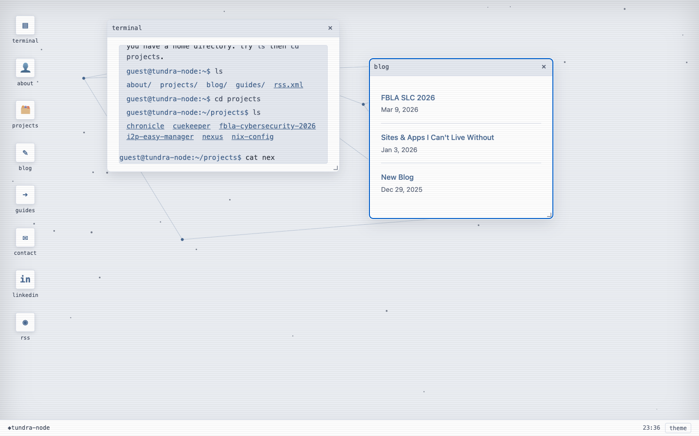

# TundraOS

Elias Zeiner's personal website, built as a desktop operating system that runs in the browser. It's a portfolio, a blog, and a homelab all in one: the whole site is a draggable, resizable OS.

Live at [tundra-node.github.io](https://tundra-node.github.io/).


<details>
<summary>Light theme</summary>



</details>

## What it is

- **The site is the OS.** Every page is a full-screen desktop with a taskbar, app icons, and windows. Move to `/about/` and you're looking at the about window on your desktop, not a separate page layout.
- **A real terminal.** Type `help` on the homepage for a command list. There's a virtual filesystem with `ls`, `cd`, `pwd`, and `cat`, built from the site's own content collections. `ls` then `cd projects` to browse what I've built. Tab completes, arrow keys walk history.
- **A live desktop.** Windows drag by their title bars, stretch from the bottom-right corner, and layer with proper focus. The taskbar clock runs, the theme toggles dark/light, and the wallpaper is a network graph of my homelab that drifts and reacts to your cursor.
- **Everything's real.** Projects, blog posts, and guides are all content collections. RSS, sitemap, JSON-LD, and SEO are handled the old-fashioned way, inside the windows.
- **Small.** No framework runtime. The homepage is about 23 KB of HTML plus 15 KB of CSS and JS (about 10 KB gzipped in total).

## Sections

- `/`: desktop with terminal, about, projects, blog, guides, contact
- `/about/`: who I am and what I do
- `/projects/`: privacy tools, homelab configs, open source
- `/blog/`: notes and posts
- `/guides/`: how-tos for I2P, self-hosting, and privacy tools
- `/rss.xml`: feed

## Accessibility

- All content is reachable from the keyboard: desktop icons and links are normal links, a skip link jumps to the open window, and Escape closes the active window and puts focus back on its icon. Dragging and resizing windows is mouse-only.
- Text meets WCAG AA contrast in both themes.
- With `prefers-reduced-motion`, the wallpaper stops moving and the snow is turned off.
- On phones the icons become a top bar and windows go full width.

## Tech

- [Astro](https://astro.build) 7 with MDX, content collections, RSS, and sitemap
- Vanilla JS/TS for the window manager, wallpaper canvas, and terminal
- Dark/light Nord themes, stored in `localStorage`, no framework
- Deployed to GitHub Pages by GitHub Actions on push to `main` (`.github/workflows/deploy.yml` runs `npm ci`, `npm run check`, `npm run build`, then uploads `dist/`)

## Development

Needs Node 22.12 or newer.

```bash
npm ci
npm run dev       # local dev server at http://localhost:4321
npm run check     # astro check (TypeScript and template errors)
npm run build     # static build to dist/
npm run preview   # serve the build
```

There are no environment variables. Site name, email, and social links live in `src/consts.ts`.

To add a post, guide, or project, drop a Markdown file in `src/content/blog/`, `src/content/guides/`, or `src/content/projects/`. The frontmatter schema is in `src/content.config.ts`. New entries show up in the windows, the terminal filesystem, the RSS feed, and the sitemap.

## Layout

```
src/
  components/   Window, Terminal, ThemeToggle
  content/      blog, guides, projects (Markdown)
  layouts/      Base.astro: desktop shell, wallpaper, window manager
  pages/        routes; each page renders inside a window
  styles/       global.css (themes and desktop styles)
public/         favicon, og image, robots.txt, llms.txt
docs/           README screenshots
```

## Built as a Stardust mission

This project was built and submitted through Hack Club's Stardust program: a personal site, a web OS, and a second round of customization all in one.

## AI usage

Parts of this repo were written with help from AI coding agents, including an October 2026 cleanup pass (type-check fixes, contrast and keyboard fixes, this README and the screenshots).

## License

Code is under the [MIT License](LICENSE). The writing in `src/content/` is mine; please ask before reusing it.
