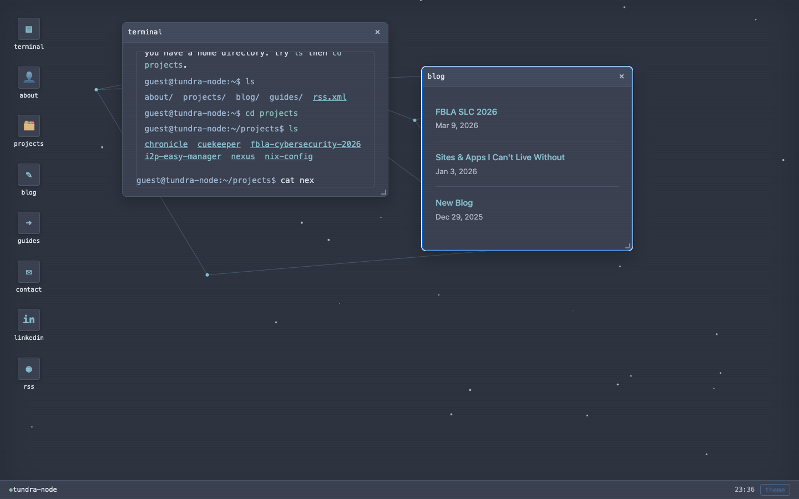

# tundra-node — terminal site

Elias Zeiner's personal website, rebuilt as a terminal / Neofetch-inspired interactive page.

Live at [eliasz.codeberg.page](https://eliasz.codeberg.page/).



## What it is

- **A terminal in the browser.** Type commands at the prompt (`help`, `about`, `projects`, `contact`, `clear`, `neofetch`, `whoami`, `ls`, `date`, `echo`, `history`, `sudo`, `exit`). Nav links at the top run the same commands.
- **Neofetch header.** ASCII art logo on the left, system/bio/link info on the right.
- **Keyboard-driven.** Enter executes, Up/Down walk history, Tab completes, input re-focuses after every output.
- **Small & dependency-free.** Vanilla HTML/CSS/JS — no build step, no framework, no runtime. Just static files.
- **Content carried over** from the previous Astro version: bio, links, and the 6 projects (Nix Config, CueKeeper, I2P Easy Manager, Nexus, Chronicle, FBLA Cybersecurity Study App).

## Sections

| command | what it does |
|---------|--------------|
| `help` | list all commands |
| `about` | bio and system information |
| `projects` | list projects with stack, status, repo/live links |
| `contact` | email, Codeberg, LinkedIn, site links |
| `clear` | clear the terminal screen |
| `neofetch` | show system information block |
| `whoami` / `pwd` / `ls` | basic shell-like commands |
| `date` / `echo` / `history` | standard CLI utilities |

## Deployment — Codeberg Pages

This is a pure static site. Codeberg Pages serves it directly — no build step required.

### Repository structure (repo root = publishing directory)

```
index.html          <- Neofetch header + terminal (entry point)
style.css           <- dark terminal theme
app.js              <- CLI logic (input buffer, history, commands)
data.js             <- embedded site data (bio, links, projects)
404.html            <- terminal-styled "not found" page
.nojekyll           <- empty; tells Pages to skip static-site processing
public/             <- favicon, og image, robots.txt, llms.txt
docs/               <- screenshots
src/                <- old Astro source (kept, not served)
astro.config.mjs    <- old Astro config (kept, not served)
package.json        <- old Astro tooling (kept, not served)
```

### Enabling Codeberg Pages

1. Push this repo to Codeberg (`git remote add codeberg https://codeberg.org/eliasz/eliasz.codeberg.page.git` then `git push codeberg main`).
2. Go to your repository on Codeberg → **Settings** → **Pages**.
3. Set **Branch** to `main` and **Directory** to `/` (root).
4. Click **Enable Pages**.
5. The site will be live at `https://eliasz.codeberg.page/` (a few minutes to propagate).

The `.nojekyll` file at the root prevents any static-site-generator processing, and relative links mean the page works regardless of the base path.

### Local development

No install required — just open `index.html` in a browser:

```bash
# serve locally (optional, uses Python)
python3 -m http.server 8000
# then visit http://localhost:8000
```

Or open `index.html` directly from the file system.

## Tech

- Vanilla HTML5 / CSS3 / ES6 (no framework, no build tool)
- Dark high-contrast terminal theme (Nord-inspired ANSI palette)
- Responsive layout (stacks on mobile)
- Deployed to Codeberg Pages from branch `main`, directory `/`

## License

Code is under the [MIT License](LICENSE). The writing is mine; please ask before reusing it.
